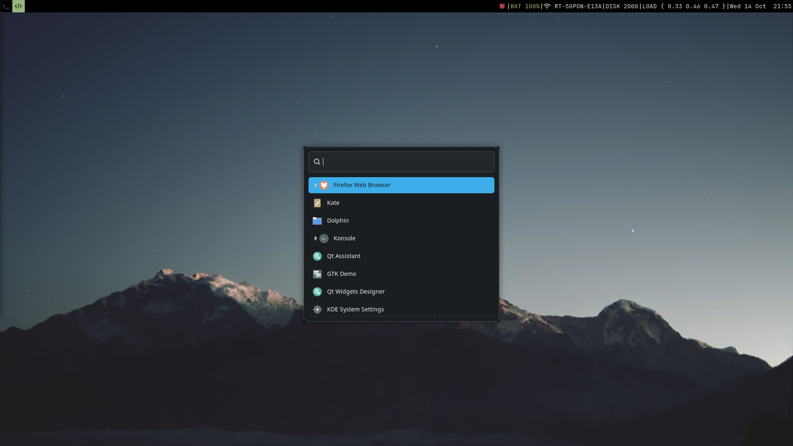
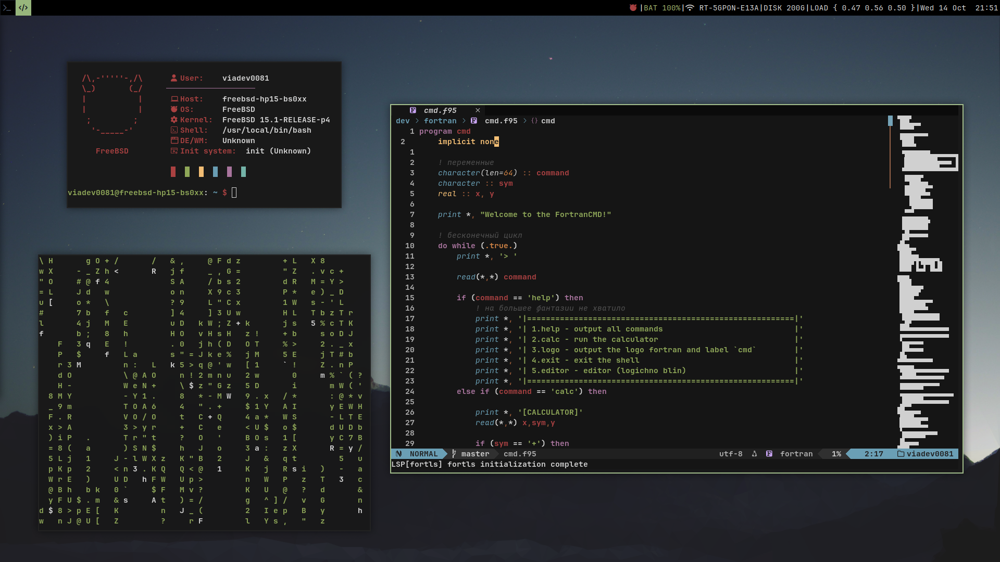
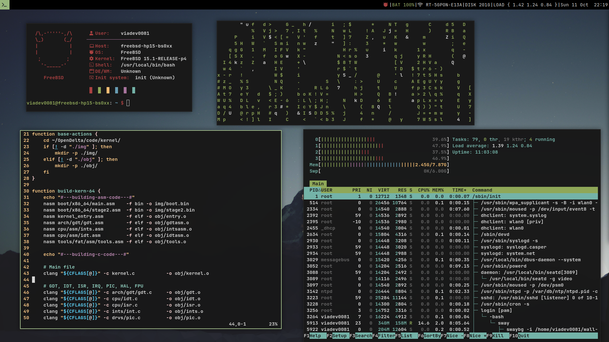

# freebsd-dots
My FreeBSD + SwayFX setup.

# Screenshots

# Dependencies:
dbus, xorg, wayland, swayfx, wlroots, swaylock, wofi, alacritty, bash, seatd, bazu, consolekit2, drm-kmod, linux emulation.
